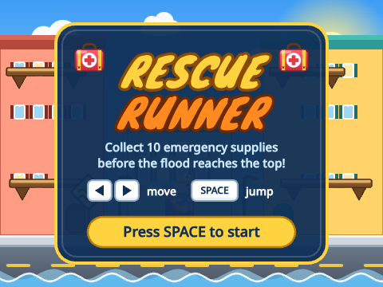
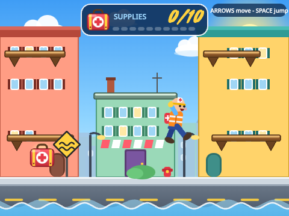
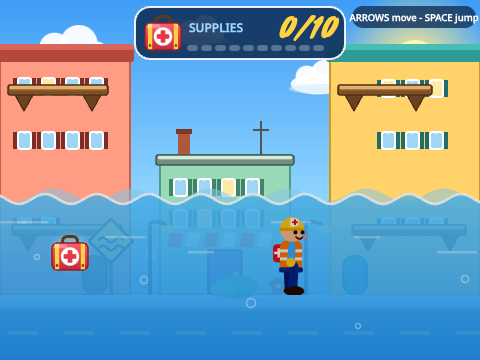
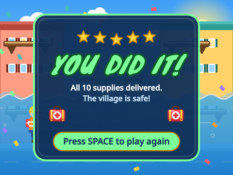
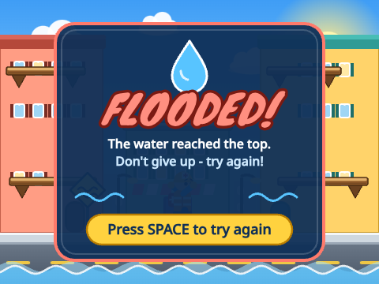

# Rescue Runner — a Scratch 3.0 STEM game

**Rescue Runner** is a flood-rescue game made entirely with Scratch 3.0 blocks.
Collect **10 emergency supplies** before the rising floodwater reaches the top of the screen!

The finished game is the file **`Rescue_Runner.sb3`**.

## How to open it
1. Go to <https://scratch.mit.edu/projects/editor/>
2. **File → Load from your computer** → choose `Rescue_Runner.sb3`
3. Click the **green flag** 🏁 (above the stage) and press **SPACE** on the title card.

Nothing else is needed: no extensions, no internet services, no custom JavaScript.
Every script is made of normal Scratch blocks that you can open, read and change.

## How to play
| Key | What it does |
|---|---|
| **← / →** | run left / right |
| **SPACE** (or **↑**) | jump |

* Run and jump to each **red emergency supply crate** (it glows and floats).
* Each crate adds **1** to your score. The scoreboard at the top shows `0/10` … `10/10`.
* The flood **rises slowly** (about 2 minutes from bottom to top) and the water gets darker the higher it climbs.
  Wading through water slows you down, and an alarm sounds when it gets high.
* **Get 10 supplies → YOU DID IT!** — **Water reaches the top → FLOODED!**
* Press **SPACE** on the end screen to play again. (The green flag also resets everything.)

Tips: use the brown balconies and the middle roof as stairs — the supplies are always somewhere you can reach.
Each balcony is one jump above the one before.

## The four sprites
| Sprite | What it does |
|---|---|
| **Rescue Runner** | The player. 11 costumes: standing, a 6-picture walking cycle, jump, fall, cheer and worried. Reads the arrow keys and SPACE, falls with gravity, lands on the street, balconies and the roof. Cheers when you win. |
| **Emergency Supply** | The crate. Appears at one of 9 reachable places (kept in two lists), bobs and glows, and when the runner touches it: +1 score, a star-burst, then it pops up somewhere new. Never appears under water or right on top of you. |
| **Rising Water** | The flood. 6 wave costumes make the surface move. Every frame it rises a tiny bit and gets darker. If it reaches the top, it announces **Game Lost**. |
| **Game Controller** | The referee. Shows the title card, the scoreboard (11 costumes: `Score 0` … `Score 10`), the win and lose screens, plays the music and jingles, and handles restarting. It can only end the game once, so a win and a loss can never both happen. |

The **Stage** holds the *Flooded Village* backdrop (sky, clouds, buildings, balconies, street) — no extra sprites were used for scenery.

## Variables and messages (for the presentation)
| Variable | Meaning |
|---|---|
| `Score` | how many supplies you have collected (0 → 10) |
| `Water Level` | height of the water surface (−168 at the start … 172 = top of the screen) |
| `Game State` | `title`, `playing`, `won` or `lost` — every loop checks it, so everything stops when the game ends |
| `Vertical Speed` | how fast the runner is moving up (+) or down (−): jump = +14, gravity = −1 every frame |

Broadcast messages: **Start Game**, **Supply Collected**, **Game Won**, **Game Lost**.

### The most important blocks
* **`repeat until <Game State ≠ playing>`** — the runner's main loop: *Move Left Right*, *Jump And Gravity*, *Pick Costume*.
* **Custom blocks** (look in *My Blocks*): `Move Left Right`, `Find Floor`, `Apply Gravity`, `Jump And Gravity`, `Pick Costume`, `Pick Spot`, `Check Spot`, `Collect Supply`, `Start New Game`, `Wait For Restart` … they make the long scripts read like sentences.
* **Gravity:** `change Vertical Speed by -1` then `change y by Vertical Speed`; if `y position < Floor Y` → `set y to Floor Y` and `set Vertical Speed to 0` (the runner can never fall through the ground).
* **Collecting:** `if <touching Rescue Runner?>` → `change Score by 1` → `broadcast Supply Collected`.
* **The flood:** `change Water Level by 0.09` and `go to x: 0 y: Water Level` every frame.
* **Winning / losing:** `if Score = 10 → broadcast Game Won`; `if Water Level > 172 → broadcast Game Lost`.
* **Random supplies:** `pick random 1 to (length of Spot X)` picks a place from a list.
* **Sensing & operators:** `key pressed?`, `touching?`, `join`, `mod`, `floor`, `sin`, `and/or/not`.

Every important script also has a **yellow comment note** attached in the editor that explains it.

## Screenshots
    

## Test summary
See [`docs/TEST_REPORT.md`](docs/TEST_REPORT.md).

## Rebuilding the project (optional, for developers)
The `.sb3` is generated by Python scripts (no hand-edited binary):
```
python3 build/build.py          # writes Rescue_Runner.sb3
python3 tests/validate_sb3.py   # structural checks
node tests/schema_check.js      # official scratch-parser schema check
node tests/run_tests.js         # plays the game in the real Scratch VM (after: cd tests && npm install)
```
See `docs/` for the seven development loops and the final test report.
